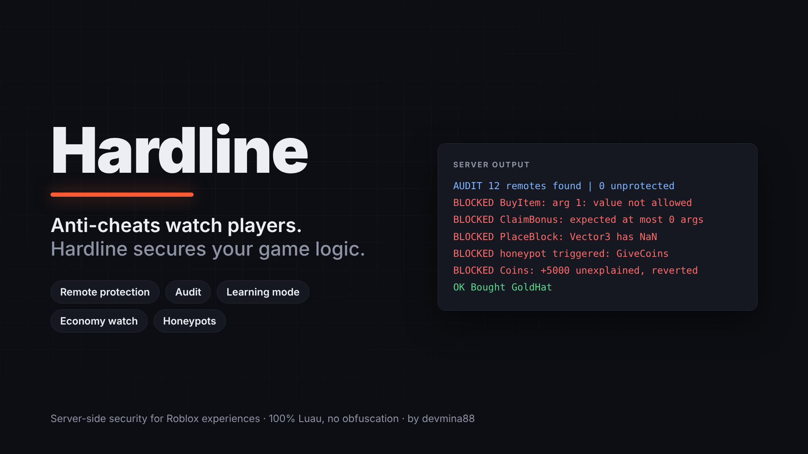
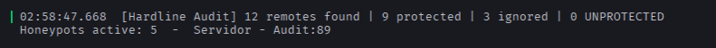
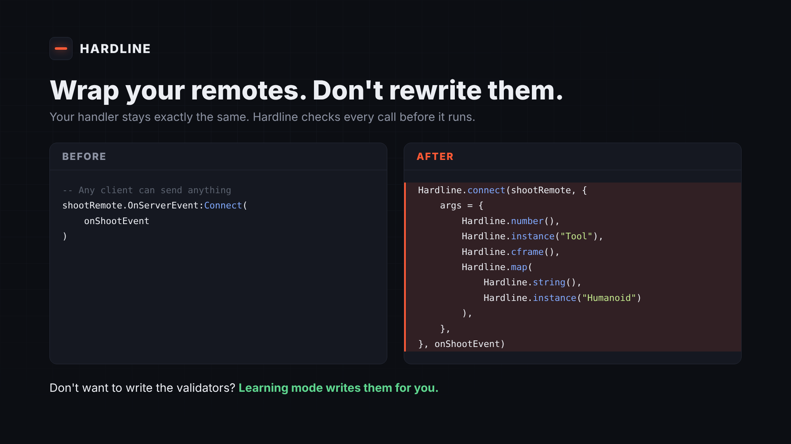

# Hardline Lite

**Free, server-side protection for your Roblox RemoteEvents.**

Exploiters rarely need to beat Roblox's anti-cheat. They call your RemoteEvents with values your UI would never send: a negative price, an item that doesn't exist, a CFrame full of NaN. Roblox can't block that for you, because only your game knows what a valid call looks like.

Hardline Lite shows you which remotes are exposed and checks every call on the server before your code runs.

## What it does

- **Audit.** When your server starts, Hardline lists every remote a client can reach and tells you which ones are unprotected.
- **Validation.** Wrap a remote and Hardline checks argument count, types, ranges, instances, Vector3, CFrame and tables before your handler runs. Your handler code stays the same.
- **Strikes, not silence.** Invalid calls become strikes with the player's name, so you see who is probing your game. Log-only by default; kicking is opt-in.
- **Works with what you have.** Already validating with the `t` library? Pass your existing validators and keep them.
- **100% server-side, readable Luau.** Exploiters can't delete or disable it, and you can audit every line.



## Installation

1. Download `Hardline-Lite-1.0.0.zip` from the [latest release](../../releases/latest).
2. In Roblox Studio, drag `Hardline-Lite.rbxm` into **ServerScriptService**.
3. Require it from any server Script:

```lua
local Hardline = require(game.ServerScriptService.Hardline)
```

Play your game. After a few seconds the Output shows the audit:

```
[Hardline Audit] 5 remotes found | 3 protected | 1 ignored | 1 UNPROTECTED
  UNPROTECTED: ReplicatedStorage.GiveReward (RemoteEvent)
```

Using Rojo? Copy `src/Hardline` into your project instead.

## Quick start

### Protect a RemoteEvent

```lua
local ReplicatedStorage = game:GetService("ReplicatedStorage")
local Hardline = require(game.ServerScriptService.Hardline)

Hardline.connect(ReplicatedStorage.ClaimBonus, {
	args = {}, -- the client must send nothing
	rateLimit = { max = 1, window = 10 }, -- once every 10 seconds
}, function(player)
	-- Only runs if the call passed every check.
	-- The server decides the amount, never the client.
	player.leaderstats.Coins.Value += 10
end)
```

### Add it to code you already have



```lua
-- Before
shootRemote.OnServerEvent:Connect(onShootEvent)

-- After
Hardline.connect(shootRemote, {
	args = {
		Hardline.number(),
		Hardline.instance("Tool"),
		Hardline.cframe(),
		Hardline.map(Hardline.string({ maxLength = 4 }), Hardline.instance("Humanoid"), { maxSize = 64 }),
	},
}, onShootEvent)
```

### Already using `t`?

```lua
Hardline.connect(plantSeedRemote, {
	validate = t.tuple(t.instanceOf("Player"), t.string, t.Vector3),
}, onPlantSeed)
```

Your `t` checks keep working, and every failure now becomes a strike with the player's name.

### Mark server-to-client remotes

The audit can't tell which remotes only send data from the server to clients. Mark those so they stop showing up:

```lua
Hardline.ignore(ReplicatedStorage.Notify)
```

### Turn on kicks when you trust it

```lua
Hardline.configure({ kickAt = 10 }) -- kick after 10 strikes within 60 seconds
```

## API

| Function | What it does |
| --- | --- |
| `Hardline.connect(remote, options, handler)` | Protects a RemoteEvent or UnreliableRemoteEvent |
| `Hardline.connectFunction(remote, options, handler)` | Protects a RemoteFunction. Rejected calls return `nil` |
| `Hardline.ignore(remote)` | Marks a server-to-client remote so the audit skips it |
| `Hardline.audit()` | Runs the audit again and returns the report |
| `Hardline.flag(player, reason, weight?)` | Adds strikes from your own checks |
| `Hardline.configure(settings)` | Changes settings (see below) |

**Options for `connect` and `connectFunction`:** `args` (one validator per argument), `validate` (a whole-call check such as `t.tuple(...)`), `rateLimit` (`{ max, window }`; extra calls are dropped without strikes).

**Validators:** `number({ min, max, integer })`, `string({ maxLength, oneOf })`, `boolean()`, `instance(className)`, `vector3({ maxMagnitude })`, `cframe()`, `map(key, value, { maxSize })`, `array(item, { maxSize })`, `optional(validator)`, `any()`. Number, Vector3 and CFrame validators reject NaN and infinity.

**Settings:** `strikeWindow` (60), `kickAt` (0 = log only), `kickMessage`, `onStrike(player, reason, strikes)`, `autoAudit` (true), `auditDelay` (5), `followUpAuditDelay` (30).

## Limitations

- Hardline does not detect movement exploits (speed, fly, teleport).
- The audit only sees remotes that exist when it runs. It runs again automatically after the first player loads in, and you can call `Hardline.audit()` yourself.
- Strikes are stored per server and reset when the player leaves.
- No anti-exploit catches everything.

## Hardline Pro

Hardline Pro is the same code plus four modules. Upgrading is just replacing the folder:

- **Learning mode:** watches your unprotected remotes while you play and writes the `Hardline.connect` code for you.
- **Watch:** detects and reverts impossible currency gains instantly, even from exploits nobody has seen yet.
- **Honeypots:** decoy remotes that catch exploiters with certainty.
- **Secure purchases:** server-side prices, double-spend protection and automatic refunds.

Coming soon on BuiltByBit.

## License and credits

Free to use in your own experiences, including commercial ones. No redistribution or resale. See [LICENSE.md](LICENSE.md).

Built with AI assistance (Claude); designed, tested in real Roblox games and maintained by devmina88.
